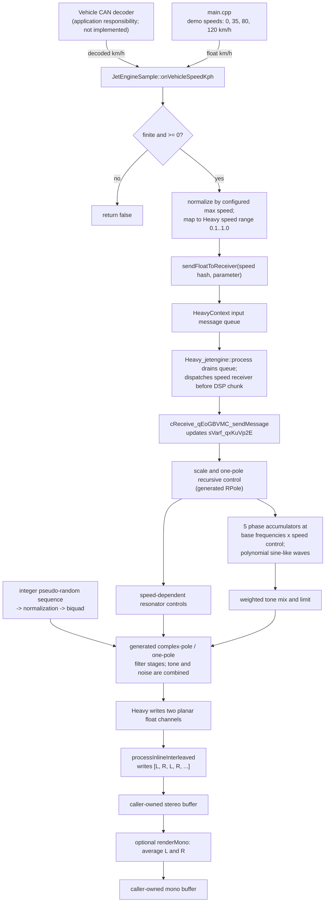

# Vehicle speed to audio: code flow

This document describes the checked-in sample and generated Heavy patch. It
does not assume a CAN device, audio device, or patch source file that is not in
this repository.

## End-to-end flow



In the diagram, “speed control” is a descriptive name for the generated signal
after its multiply and `sRPole_Tkqarq6a` stage; it is not a separate public
parameter.

## Speed input and mapping

`main.cpp` creates `JetEngineSample` with a 48,000 Hz sample rate and a
maximum vehicle speed of 250 km/h. The demo supplies four example speeds; it
does not read CAN. In an application, the CAN decoder must decode the correct
message and apply that vehicle's byte order, scale, and offset before calling
`onVehicleSpeedKph()`.

The adapter:

1. Rejects non-finite speeds and speeds below zero (`false`).
2. Divides the speed by the configured maximum.
3. Caps the normalized value at 1.0.
4. Maps it to the generated patch's `speed` parameter range.
5. Queues that parameter value for Heavy.

With the checked-in 250 km/h maximum, the mapping is:

```text
u = min(speedKph / 250, 1)
parameter = 0.1 + (1.0 - 0.1) * u
```

Thus 0 km/h maps to 0.1, 250 km/h maps to 1.0, and larger valid speeds also
map to 1.0. The configured maximum must itself be positive and finite. The
patch reports `speed` as parameter index 0, hash `0x29E4A0EF`, range 0.1..1.0,
and metadata default 0.5.

The generated `sVarf_qxKuVp2E` signal variable is initialized to 0.0. The
metadata default is not copied into that variable by the sample constructor;
the demo avoids relying on it by sending a speed before each render.

## Message handoff and timing

`sendFloatToReceiver()` creates a Heavy float message and places it on the
thread-safe input queue with zero delay. On the next `process()` call, Heavy
drains that queue, looks up the receiver hash, and schedules the message in its
message queue. The generated receiver for `0x29E4A0EF` is
`cReceive_qEoGBVMC_sendMessage`; it updates `sVarf_qxKuVp2E`. Heavy dispatches
messages whose timestamps precede the next SIMD chunk before running that
chunk's signal operations.

This is the intended split: `onVehicleSpeedKph()` may be called by the vehicle
or CAN thread, while rendering is performed by one audio thread. The Heavy
processing call itself is not thread-safe and should not be called concurrently.

## Generated sound processing

The generated code is in `../c/Heavy_jetengine.cpp`; the original visual patch
is not included, so the description below follows the generated operations
and constants rather than assigning unverified names to sound-design controls.

1. The `speed` signal is multiplied by a loadbang-initialized value and passed
   through `sRPole_Tkqarq6a`. This stateful one-pole stage supplies the
   speed-dependent control used by the rest of the graph.
2. Five `phasor` objects use that control to scale their initialized base
   frequencies, in generated processing order: 7,471, 11,000, 3,097, 4,495,
   and 5,588 Hz. Each phase is transformed by generated arithmetic into a
   sine-like polynomial waveform (including the coefficients `-1/6` and
   `0.007833333333333`).
3. The five waveforms are mixed in pairs: the first pair is scaled by 0.4, the
   next pair by 0.25, and the fifth is added at its generated level. This mix
   is limited to -0.9..0.9.
4. A separate integer state is advanced with a multiply by 16,807, converted
   to float with a scale of `4.65661e-10`, and passed through the generated
   `SignalBiquad_k` filter. Loadbang messages initialize the patch's frequency
   and filter controls.
5. The graph derives additional controls from the speed-dependent signal,
   including a squared path scaled by 150 and another path scaled by 12,000.
   The generated `SignalCPole` complex-pole stages and `SignalRPole` recursive
   stages use these controls to process and combine the tonal and filtered
   noise signals. A `SignalDel1` stage is also present in the generated path.
6. The final signal is scaled by 0.1 and written to both output accumulators.

These are the operations encoded in the generated C++; names such as
“engine RPM,” a vehicle-specific speed curve, or acoustic behavior beyond
those operations are not specified by the checked-in sample.

## How the output buffer is filled

`render()` requires a non-null stereo pointer and a positive frame count that
is a multiple of Heavy's compile-time SIMD width. Invalid arguments return 0.
It calls `processInlineInterleaved()` with no input buffer because the generated
context has zero input channels and two output channels. The stereo pointer
must have room for `2 * frames` floats.

For each SIMD chunk, `Heavy_jetengine::process()`:

1. Dispatches due control messages.
2. Clears its two internal output vectors.
3. Runs the generated signal graph for the samples in that chunk.
4. Stores the resulting samples in two planar channels, then advances the
   Heavy block timestamp.

`processInlineInterleaved()` uses temporary planar storage and interleaves it
into the caller's buffer as:

```text
stereoOutput[2*i]     = left sample i
stereoOutput[2*i + 1] = right sample i
```

In the checked-in generated graph, the same final signal is added to both
output accumulators. The two output channels are therefore currently identical
(dual mono), even though the context exposes two channels.

`renderMono()` requires a `frames`-sized mono buffer and a non-overlapping
stereo scratch buffer sized for `2 * frames` floats. It renders into the scratch
buffer, then fills each mono frame with:

```text
monoOutput[i] = 0.5 * (stereoScratch[2*i] + stereoScratch[2*i + 1])
```

Both output buffers belong to the caller; `JetEngineSample` does not open an
audio device, write a file, or perform a hardware playback step. The demo
renders 128 frames per supplied speed, computes the mono block's peak, and
prints it.

## Relevant files

- [`main.cpp`](main.cpp): demo inputs, 48 kHz/250 km/h configuration, and
  128-frame render loop.
- [`JetEngineSample.cpp`](JetEngineSample.cpp) and
  [`JetEngineSample.hpp`](JetEngineSample.hpp): validation, parameter mapping,
  message submission, stereo rendering, and mono downmix.
- [`../c/HeavyContext.cpp`](../c/HeavyContext.cpp): thread-safe message
  submission and input-queue handling.
- [`../c/Heavy_jetengine.cpp`](../c/Heavy_jetengine.cpp): generated receiver,
  parameter metadata, DSP graph, and planar/interleaved output conversion.
- [`../c/HvSignalVar.c`](../c/HvSignalVar.c): signal-variable updates.
- [`../c/HeavyContextInterface.hpp`](../c/HeavyContextInterface.hpp): channel,
  render-buffer, and thread-safety contracts.
